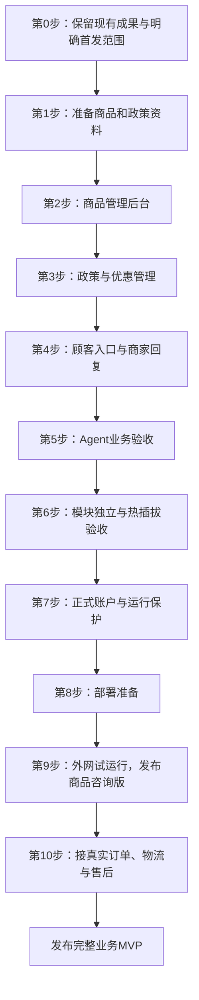

# ShopAgent AI：从当前版本到上线的具体步骤

这份文档是接下来的执行清单。每一步都说明“做什么、你准备什么、我开发什么、怎样验收”。你可以逐步完成，不需要先学会整个技术栈。

编写日期：2026-10-09。

最新补充：正式管理员初始化、生产模式、独立目录和示例资料隔离已实现，162项测试通过。生产库需你在本机初始化管理员并录入审核后的真实资料；尚未部署公网。详情见《正式模式初始化与使用指南》。

进度更新：第2步商品管理、第3步政策与优惠管理、第4步顾客入口与人工回复已实现。新增访客商品咨询入口、我的人工咨询、未读提示、商家上下文与关闭/重开、基础限流；真实资料仍需核实和发布，正式账户与公网部署尚未完成。具体操作见《顾客入口与人工回复操作指南》，剩余任务见《公网部署准备清单》。依据是原文 ShopAgent 项目和当前代码；后续“待做”不表示已经实现。

## 1. 先明确终点

最终目标：顾客打开你分享的 HTTPS 链接，就能咨询你店铺的商品和政策；接入订单平台后，还能查询本人订单、物流和授权范围内的售后。商家能维护资料、回复人工咨询。业务模块能够独立启停和更新。

建议分成两次发布：

| 发布阶段 | 顾客可以使用的功能 | 为什么这样安排 |
|---|---|---|
| 第一版：商品咨询 MVP | 真实商品查询、库存、导购、有效优惠、政策问答、人工咨询 | 可以先验证客服是否有用，不依赖订单平台授权 |
| 第二版：完整业务 MVP | 第一版 + 本人真实订单、物流、售后申请与进度 | 需要接通店铺接口，验证订单归属及真实业务操作 |

这是建议的默认顺序。如果你要求首次上线就包含真实订单，必须先完成下文第10步再对外发布，不能用示例订单代替。

第一版上线时：关闭顾客侧示例订单、物流和模拟退货入口；相应问题引导转人工。保留代码，后续接通真实接口再启用。

## 2. 我们现在在哪一步

| 当前已有 | 还缺什么 |
|---|---|
| 主客服、商品、订单、导购四个角色 | 真实店铺资料与业务接口 |
| DeepSeek 接入 | 正式使用的调用限额、失败处理及运营观察 |
| 商品、订单、物流、售后示例工具；商品、政策、优惠管理后台 | 真实资料核实与正式数据维护流程 |
| 登录、会话、售后确认、访客入口、人工回复、单进程基础限流 | 正式管理员账户、生产初始化、访客长期找回、网关与多实例限流 |
| 独立工具进程启停和兼容版本切换 | 新模块管理流程、生产故障与备份验证 |
| 本地网页 | 公网 HTTPS 地址与部署 |
| MCP SDK 本地协议会话 | 独立网络 MCP 服务（有需要时扩展） |
| python-a2a 消息与本地派发 | 跨进程网络 A2A 服务（有需要时扩展） |

当前自动化验证覆盖登录归属、Agent编排、业务工具、热插拔和管理后台；业务数据目前仍是示例。历史重构阶段的101项记录保留，最新管理后台验证见《政策与优惠后台验收记录》。

## 3. 总流程

第1步和部署资料准备可以并行；功能开发按顺序进行。网络 A2A、向量检索、多租户等扩展放在业务闭环之后。

## 第0步：保留现有成果，明确第一版范围

**目的：** 后续改动有恢复点，也不会把示例功能误当成真实业务。

我来做：

1. 保存当前代码版本，整理开发配置与生产配置。
2. 停止服务后备份业务数据；不在数据库写入时简单复制文件冒充可靠备份。
3. 给示例数据与正式数据设置明确的运行模式，生产模式禁止自动生成公开示例账户。
4. 固定第一版的功能清单，把未接通的订单能力设为关闭。

你准备：店铺名称、第一版想服务哪些顾客、是否已经有店铺和订单平台。如果暂时没有店铺，可以先做一个商品咨询试点。

**验收：** 现有数据可恢复；正式模式不会混入示例订单；首发范围写进 README。

## 第1步：准备第一批业务资料

**目的：** Agent 有真实资料可查，而不是凭模型记忆回答。

你准备下面这些内容。先整理5—10款商品就能开始，不要求一次录入整个店铺。

| 资料 | 最少需要哪些字段 | 示例格式 |
|---|---|---|
| 商品 | 编号、名称、分类、售价、规格、说明、上架状态 | 商品A / 耳机 / 189元 / 黑白两色 |
| SKU | 商品编号、颜色或规格、库存、更新时间 | 商品A / 黑色 / 12件 |
| 政策 | 配送说明、退换条件、运费承担、人工服务时间 | 用商家认可的文字逐条写清 |
| 优惠（可选） | 活动范围、有效期、折扣或门槛、是否叠加 | 指定耳机九折，到期失效 |
| 联系方式 | 希望怎样接收和回复顾客咨询 | 首版可继续使用后台工单 |

没有确认过的参数留空，不为了让页面完整而填猜测值。手工库存只能表示最近一次维护的数量，不能承诺实时库存。没有真实优惠就先关闭优惠计算。

我来做：整理成统一导入模板，检查重复编号、负数价格、无效库存和缺失规格；将“元”转为内部整数“分”。

**验收：** 至少5款商品信息完整；你确认价格和政策；每项资料有明确来源或维护人。

## 第2步：开发商品管理后台

**目的：** 以后你在网页里维护商品，不用改代码或直接修改数据库。

我按以下顺序开发：

1. 商品列表：搜索、查看、区分上架与下架。
2. 新增和编辑：名称、分类、价格、说明。
3. SKU管理：颜色、规格、库存和更新时间。
4. 下架操作：从顾客查询中移除商品，保留原记录。
5. 导入资料：预览校验结果，再确认写入；失败时给出具体行和原因。
6. 管理权限：只有商家能修改；更新记录包含操作人和时间。

复用现有商品模块。商品由自己的模块读写，其他 Agent 不直接访问它的数据库。

你来做：录入第一批商品，检查网页显示是否与自己的资料一致。

**验收：** 修改售价后，新咨询使用新售价；下架商品不再推荐；更新指定颜色库存不会改动其他 SKU；普通顾客不能调用管理接口。

## 第3步：开发政策与优惠管理

**目的：** 回答依据可维护，优惠金额由工具计算。

我来做：

1. 政策新增、编辑、发布与停用，保留版本号和生效时间。
2. 让问答检索只引用有效政策，并在页面展示来源和版本。
3. 更新现有退货规则读取逻辑，去掉只适用于示例政策的固定规则；文字说明和程序判断须保持一致。
4. 优惠管理：适用商品、有效期、计算方式、不叠加规则。
5. 优惠计算只读取数据库中的标价和有效活动，禁止模型自报价格。
6. 资料缺失或检索不到时明确说明，提供人工咨询入口。

你来做：确认最终政策文本和活动规则，不能直接套用其他商家的条款。

**验收：** 发布新政策后，新的问答引用新版本；停用政策不再检索；过期优惠不计算；没有适用活动时不编造折扣。未来售后提交前必须重查当前适用规则。

## 第4步：整理顾客入口和人工服务流程

**本地功能已完成。** 顾客入口为 `/customer`，商家入口为 `/merchant`；访客商品咨询与演示订单隔离。未读检查和人工回复闭环已验收；店铺名称、服务时间、真实资料与生产身份方案仍需准备。

**目的：** 顾客打开链接后知道怎么用，商家知道在哪里处理咨询。

我来做：

1. 顾客首页：店铺名称、欢迎语、常见问题、咨询输入框。
2. 商品卡片：价格、规格、库存更新时间、政策引用。
3. 商家后台：商品、政策、人工咨询、系统设置分别放置。
4. 技术角色说明仅作为帮助页面，不让顾客先学 Agent 才能咨询。
5. 转人工后显示当前处理状态；商家回复保留在原会话。
6. 手机体验：输入、发送、卡片、刷新回复都能正常使用。

你准备：店铺名称、欢迎语、人工服务时间。若暂不做短信或邮件通知，页面须明确顾客怎样查看回复，不能承诺即时通知。

**验收：** 新用户不用指导也能发出第一个问题；商家能找到并回复咨询；顾客在原会话看到回复；未接通的订单能力不出现假订单入口。

## 第5步：验收 Agent 的业务能力

**目的：** 确认它能处理真实资料，出错时有清楚的兜底。

我来做：根据你准备的资料建立至少20条代表性问题，测试简单查询、跨角色协作、追问、资料缺失、工具故障和模型失败。自动化回归使用模型桩，另做少量真实 DeepSeek 验证。

你来做：以顾客身份提问，检查内容，而不只看“页面有没有返回文字”。

| 验收问题 | 合格结果 |
|---|---|
| 某款商品多少钱？ | 与商家录入价格一致 |
| 黑色还有货吗？ | 查对应SKU，说明库存更新时间 |
| 推荐预算内商品 | 不推荐超预算或下架商品 |
| 比较两款商品 | 只比较已查证的价格和参数 |
| 推荐、查库存、算优惠 | 分阶段协作，不重复计算、不编造优惠 |
| 第一款白色呢？ | 能根据当前会话找到正确商品 |
| 没录入的防水等级是什么？ | 说明无法核实，不猜参数 |
| 政策有冲突或资料缺失 | 澄清或转人工 |
| 模型超时或模块停用 | 给出可理解的失败提示，不显示内部异常或密钥 |

**验收：** 每个失败案例都有修复或明确处理方式；关键价格、库存、权限和确认错误不能带入公开试用。保留测试记录，不把一次成功当成所有问题都正确。

## 第6步：验收模块独立与热插拔

**目的：** 保留你要求的模块独立性，后续替换数据来源不重写整个项目。

现有 Agent 角色和工具模块是两层：专业角色目前在主程序内运行；商品、订单等工具模块是独立进程，可运行时启停和切换兼容版本。

我来做：

1. 每个模块只读写自己的数据；跨模块通过接口调用。
2. 新增管理功能仍放在对应模块，不堆进主 Agent。
3. 停用导购，验证商品查询继续工作；停用物流，验证订单查询继续工作。
4. 验证依赖关系：导购依赖商品，物流依赖订单，售后依赖订单和政策。
5. 切换模块版本，验证旧请求完成、新请求使用新版本；新版本启动失败时保留旧版本。
6. 验证失败模块不会拖垮其他独立业务，并能在后台看出状态。

**验收：** 独立能力可以恢复；依赖模块停用时不给出假成功；无需清空数据库或重启全部服务来完成已有的兼容版本切换。

如果你还要求“Agent 本身也可运行时启停或独立部署”，需要另做角色启停注册、在途任务处理和网络 A2A。这项目前未完成，应单独验收，不能用工具模块热插拔代替。

## 第7步：增加正式账户和运行保护

**目的：** 公开链接后，不能继续依赖公开示例密码和无限模型调用。

我来做：

1. 商家使用正式管理员账户，禁用生产环境示例登录。
2. 第一版可采用受限访客咨询；若查询订单，必须绑定可验证的店铺用户身份。
3. 访客会话使用服务器生成的随机凭据并隔离，不能靠提交会话编号访问别人的聊天。
4. 登录、发消息和模型调用限流，限制消息长度、并发数和单轮工具次数。
5. 增加可调整的调用预算与暂停开关，模型额度不足时引导人工。
6. 会话和日志避免保存密钥；设定记录保存期限、管理员访问范围与删除方式。
7. 业务管理、人工回复、订单与售后接口逐项验证权限。

你准备：正式管理员账户信息、可接受的模型调用预算、希望保留聊天多久。密码和密钥在配置时由你本地填写，不发进聊天。

**验收：** 公开示例密码不能登录正式环境；不同访客或用户的会话互相隔离；超限请求被控制；日志和页面不暴露密钥。

## 第8步：准备部署

**目的：** 把“只在你电脑运行”变成“服务器持续运行”。

你准备：可使用的服务器或托管平台账号；域名（如需要）；部署预算。到这一步再根据实际资源选择平台，不必现在购买所有东西。

我来做：

1. 固定依赖版本，生成部署配置与操作说明。
2. 区分开发和生产环境；服务器密钥通过受控配置注入。
3. 配置数据持久化，重启或更新应用不能丢失商品和聊天。
4. 配置 HTTPS 与公开网页入口；业务插件和内部签名接口不对外暴露。
5. 配置进程重启、健康检查、日志轮转和错误观察。
6. 生成备份，实际执行一次恢复；保留上一版本回退方法。
7. 根据部署形态适配数据库。现有 SQLite 可用于小规模单实例试点；多实例或更高写入需求需规划共享数据库，不能让多个实例各保存一份不同数据。

**验收：** 在干净环境按说明能启动；服务器重启后数据仍在；HTTPS入口正常；外网不能访问内部模块；备份确实能恢复。

## 第9步：外网试运行，发布商品咨询版

**目的：** 验证真实访问条件下可用，再逐步放给顾客。

我和你一起做：

1. 用手机移动网络打开正式链接，不仅在开发电脑访问。
2. 测试商品、导购、有效优惠、政策、转人工和回复。
3. 测试不同设备、不同账户或访客会话的隔离。
4. 检查模型超时、停用模块、服务器重启后的表现。
5. 先给少量受邀用户试用，收集错误和不清楚的页面提示。
6. 修复影响使用的问题，再扩大分享范围。

你来做：判断回答是否符合店铺实际；安排谁处理人工咨询；确认能接受的响应体验。

**第一版发布门槛：** 商品和政策真实可维护；关键问题验收通过；正式入口与权限可用；调用量受控；备份能恢复；未接通的业务明确关闭。

交付物：可访问的 HTTPS 链接、商家操作指南、部署与恢复说明、验收记录。

## 第10步：接入真实订单、物流与售后

**目的：** 完成原文中订单 Agent 的真实业务闭环。

你准备：实际订单来源、平台名称、接口可用情况、店铺用户身份如何确定、允许自动处理哪些售后。平台授权在对应平台完成，不把密钥直接贴进聊天。

我按以下顺序做：

1. 接身份映射：平台用户与客服会话账户对应。
2. 接本人订单查询：不能仅凭订单号查询任何人的订单。
3. 接物流轨迹：保留来源和更新时间，未知到货时间不猜测。
4. 接售后资格查询：按该订单、商品和适用政策判断。
5. 生成真实申请草稿：展示商品、原因、金额或处理范围等必要信息。
6. 顾客确认后提交：再次验证身份和条件，使用幂等标识防重复；网络结果不明时先核对状态，不盲目重提。
7. 接售后状态查询与人工异常处理。

退款、取件和审核结果由真实业务平台决定；接通申请接口不等于模型可以自由退款。

**验收：** 其他人的订单查不到；重复确认不重复创建申请；提交失败或结果不明确有恢复流程；真实平台状态与客服显示一致。

没有真实接口时，订单服务继续保留为本地开发演示，线上引导人工。不能把这一阶段写成已完成。

## 4. 以后再扩展哪些能力

| 扩展项 | 什么时候需要 | 当前是否必需 |
|---|---|---|
| 网络 A2A、Agent独立部署 | 多机器协作、独立更新专业角色 | 商品咨询首发不是前置条件 |
| 独立网络 MCP 服务 | 外部客户端或其他系统使用同一套工具 | 当前本地协议会话可先复用 |
| 向量检索与重排序 | 政策和商品资料增多，关键词检索表现不足 | 先用真实问题评估，再决定 |
| 多租户 | 同一系统服务多家店铺 | 当前单店铺先不做 |
| 更多 Agent | 新业务无法清楚归入现有角色 | 先完成现有三个业务角色 |

如果目标是原文技术栈完整复现，网络 A2A、独立 MCP、数据库及部署方案要作为后续独立阶段补齐；商品咨询 MVP 上线不代表技术栈复现全部完成。

## 5. 你现在实际要做的第一件事

准备第一批商品和政策，按这个清单整理即可：

- [ ] 店铺名称和主营类别。
- [ ] 5—10款商品的名称、价格、规格、说明与库存。
- [ ] 配送说明和退换政策。
- [ ] 是否有真实优惠；没有就写“暂不做优惠”。
- [ ] 是否有真实订单平台；没有就写“第一版只做商品咨询”。
- [ ] 谁负责人工回复、服务时间是什么。

资料齐后，下一项开发任务就是 **第2步：商品管理后台**。由我完成代码和验证，你负责确认业务资料并在网页验收。不需要你先理解所有源代码。

每一步都按“准备资料 → 开发 → 本地验收 → 记录结果”推进，完成后再进入下一步。时间取决于资料和接口是否齐备，不用未经验证的日期承诺代替完成标准。

## 6. 相关文档

- [项目入口](../README.md)
- [新手使用与学习指南](MVP使用与学习指南.md)
- [原文对照和代码迁移](MVP原文对照与迁移.md)
- [当前系统架构](ShopAgent系统整体架构.md)
- [当前重构验收记录](MVP重构验收记录.md)

## 2026-10-10 运营阶段进展

店铺信息、欢迎语、人工服务说明维护已完成；每日模型调用额度支持持久化、暂停及并发占额。停机备份、校验与恢复到新目录工具已完成，并演练开发数据恢复。恢复后默认暂停真实模型并作废旧登录凭据。下一步继续可信网关及部署准备，同时由商家准备正式管理员和真实资料。详细步骤见《店铺运营与备份恢复操作指南》。

## 2026-10-10 网关阶段进展

已完成宿主请求边界、显式同机代理信任、正式 API 文档关闭；Nginx HTTPS 与限流模板通过本机实际测试。完整回归193项通过。Linux服务守护模板已提供，但尚未在服务器运行。用户目前无服务器和域名，继续做本地部署准备；下一阶段需隐私告知、数据保留与清理及错误监控，正式账号与真实资料仍需商家准备。部署执行流程见《公网网关与服务器部署步骤》。

## 2026-10-10 咨询数据与维护阶段进展

顾客阅读说明、正式访客版本校验、过期访客清理预览与默认关闭的定时执行已实现；后台可查看脱敏运行事件与模块故障。原数据未启用清理。下一步做整体验收与部署资料整理；真实管理员、真实资料、保留安排、服务器和外网验收仍待准备。
