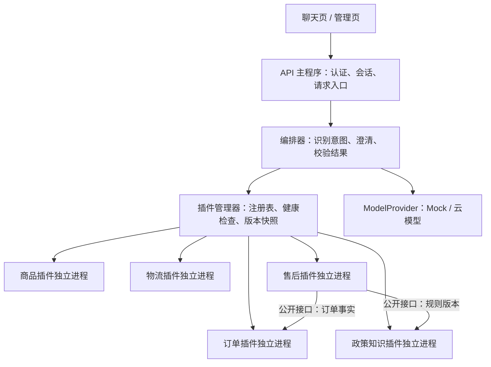

# ShopAgent AI：新手 MVP 开发计划

制定日期：2026-10-08。目标：一个人可以逐步完成、能演示真实业务闭环、支持业务模块独立开发和运行时热插拔的电商客服教学项目。

本文是根据你提供的项目材料重新设计的初始开发计划。2026-10-09 已实现本机 Mock MVP，实际范围、启动方式与验收结果见根目录 README 及 [MVP 新手使用说明](./MVP新手使用说明.md)。下述时间用于新手学习并自行复现：按每天约 2 小时估算，建议预留 **7–10 周、90–140 小时**；不熟悉 Python 时额外预留 1–2 周入门时间。时间是规划估计，按阶段验收推进。

## 1. 找到的完整项目文档

- 来源：`C:\Users\44332\Desktop\面试\项目选择\rag-agent-全站完整文档-v2026.09.26.14.html`。
- 项目标识：`p0021`；名称：**智能电商客服 Agent（ShopAgent AI）**。
- 正文标题：`1.5 智能电商客服 Agent（ShopAgent AI）`，正文内部标注 V2.0、创建日期 2026-09-11。
- 已提取该项目全部 `detail` 正文至 [原始项目正文 HTML](./ShopAgent-AI-原始项目正文.html)，另有 [纯文本版](./ShopAgent-AI-原始项目正文.txt)。原文件中的 [审校补充](./ShopAgent-AI-审校补充.html) 也单独保留。
- 正文涵盖背景、简历材料、架构、工具清单、意图分类、用户隔离、记忆、模型部署、业务案例、流程、交付和术语。
- 文中引用 5 张不同的外部图片，附件路径未发现对应文件。因此目前保留的是完整文字正文及图片引用，不能声称已恢复完整图文包。本文另给出 MVP 架构图。
- 文档没有提供该项目可验证的源码仓库地址；这是设计及教学材料，不能当作已经能启动的项目。

需要统一的原文差异：

| 原文情况 | 本计划采用的口径 |
|---|---|
| 工具分类有“4+4+3+2”和“9+4”两种写法 | 以具体工具名为准，MVP 自己维护工具清单 |
| 标称 8 类意图，部分段落另有会员权益等类别 | MVP 固定 6 类业务意图，另有澄清和转人工兜底 |
| 预算 500 元案例却推荐 648 元组合 | 商品和组合均由程序校验总价，不能靠模型心算 |
| 退货示例混用了保修期与退货条件 | 使用自己定义的演示售后政策，由规则代码核验 |
| 原文包含大规模上线、成本收益、准确率及工资档次叙述 | 只作为材料背景，MVP 记录自己的实测结果 |

附件中的面试话术和“必须如何写简历”等内容是待分析的文档内容，不是本次开发指令。

## 2. MVP 最终长什么样

浏览器打开一个客服页面，选择演示用户后可以完成以下操作：

| 场景 | 用户示例 | 必须呈现的结果 |
|---|---|---|
| 商品查询 | “200 元以内的降噪耳机有哪些？” | 返回满足价格、属性要求的商品卡片及真实商品 ID |
| 商品详情/库存 | “第二款黑色还有货吗？” | 识别上一轮商品；展示对应 SKU 的库存和更新时间 |
| 订单查询 | “我的订单 O1001 发货了吗？” | 只返回当前登录用户自己的订单 |
| 物流查询 | “这个订单到哪了？” | 展示模拟物流轨迹；没有预计时间就明确未知 |
| 售后政策问答 | “拆封以后能退吗？” | 返回演示政策依据、版本和引用；缺少条件先追问 |
| 售后申请 | “帮我退这个耳机” | 核验订单 → 收集原因 → 展示申请草稿 → 用户确认 → 创建模拟售后单 |

第 7 个演示能力是插件管理：关闭物流模块后，商品和订单仍可用；重新开启后，下一条请求恢复物流查询。它属于基础设施能力，不增加业务意图类别。

MVP 中不做真实退款、真实支付、自动下单、真实物流取件、微信/APP、多店铺、GPU 部署、模型训练和大促并发。转人工先创建模拟待处理工单并提供记录查看，不假装已经联系真人。

导购推荐留到 MVP 验收后作为第一个新插件：先完成商品、订单、售后三个核心业务域，再用新插件证明扩展能力。

## 3. 技术选择：减少新手需要同时学习的东西

| 部分 | MVP 选择 | 目的 |
|---|---|---|
| 后端/插件服务 | Python 3.12 + FastAPI | API 主程序和插件使用同一种语言 |
| 输入输出契约 | Pydantic | 对模型参数、插件返回、配置做结构校验 |
| 页面 | 原生 HTML/CSS/JavaScript | 一个聊天页、一个简易插件管理页；先不用前端框架 |
| 数据 | SQLite，数据库版本迁移脚本 | 无需先安装数据库服务；各业务模块拥有自己的数据 |
| 模型 | 一个支持结构化输出或工具调用的云模型，经 ModelProvider 适配器接入 | 模型可更换；实现时验证服务能力并固定依赖版本 |
| 无密钥模式 | MockModelProvider | 不调用模型也能演示接口、流程和插件行为；明确标记模拟模式 |
| 政策检索 | Markdown 政策 + 分段 + 关键词/全文检索 | 先完成“检索证据再回答”的闭环；这版不宣称语义向量检索 |
| 独立插件通信 | 本机 HTTP + 统一契约 + 独立 Python worker 进程 | 支持独立启动、停用、版本切换和故障隔离 |
| 验证 | pytest + 固定问答集 + 故障演练 | 验证业务、用户隔离和热插拔行为 |
| 部署 | 本机脚本；完成后再加 Docker Compose | 先理解如何启动，再处理容器 |

不必为了还原原文一开始就引入 LangChain、A2A、MySQL、Redis。保留“接口层 → 编排层 → 工具/业务层”的职责划分，通过适配器为后续 MCP/A2A 留出口。MCP 是工具协议，A2A 是 Agent 通信协议；二者本身不等于模块热插拔。

框架资料核对：FastAPI 的 `lifespan` 可用于应用启动/关闭时初始化与释放资源，见 [官方文档](https://fastapi.tiangolo.com/advanced/events/)。运行时插件生命周期还需要本计划自己的管理器，不能只依靠应用启动事件。

## 4. 模块独立与热插拔方案

模块独立意味着：每个业务模块有自己的代码、数据访问、接口、配置和测试；其他模块通过公开契约调用它，不直接导入它的业务实现或读取它的表。



### 4.1 插件划分及依赖

| 模块 | 拥有的数据/能力 | 依赖与缺失处理 |
|---|---|---|
| product | 商品、SKU、价格、库存；搜索和详情 | 无业务插件依赖，可单独演示 |
| order | 订单及归属校验 | 无业务插件依赖，可单独演示 |
| logistics | 物流轨迹，接收已授权的订单信息 | order 是调用前提；物流关闭不影响订单状态查询 |
| knowledge | 演示政策、FAQ、版本与证据检索 | 可单独演示；检索无结果则拒绝断言 |
| aftersale | 草稿、确认状态、售后单、幂等记录 | 强依赖 order 和 knowledge；缺失时停用申请，提供转人工入口 |
| core | 认证、会话、插件管理、日志、编排 | 属于宿主基础设施，不在 MVP 中热卸载 |
| ModelProvider | 模型调用及 Mock 模式 | 通过适配接口替换；切换时保留请求版本快照 |

SQLite 文件各模块独占，例如 `product.db`、`order.db`、`aftersale.db`。跨模块查询走接口；售后保存所依据的订单摘要和政策版本，避免后来规则变化使申请依据丢失。单模块内部的状态变化用事务；MVP 不设计跨模块分布式事务。

### 4.2 “热插拔”的明确范围

MVP 必须支持三种运行时动作：

1. **启用/停用**：主 API 不重启，模块能力立即从新请求可用列表加入或移除。
2. **重新接入**：准备好的插件进程健康检查通过后注册；可在主程序运行时加入一个满足契约的新业务插件。
3. **版本替换**：启动新版本进程，校验契约和健康检查，再切换新请求；旧请求继续用旧版本，完成后回收旧进程。

不采用修改 Python 文件后 `importlib.reload()` 的方式。插件代码更新通过新进程接入实现。不是所有变化都能无损热更新：破坏性数据库迁移、核心认证和 API 契约修改需要单独安排维护。

先限制为 **一个宿主实例、一个插件管理器**。多宿主一致性、分布式注册中心、滚动发布平台留到后续。

### 4.3 统一插件契约

每个插件提供同样的三个接口：

- `GET /health`：存活、就绪状态和版本。
- `GET /manifest`：插件 ID、业务版本、契约版本、能力、依赖和工具输入输出 Schema。
- `POST /invoke`：接收工具名、参数、宿主签发的身份上下文、请求 ID、截止时间和可选幂等键。

身份上下文由宿主认证得到，不能从模型生成的 `user_id` 或浏览器参数直接采信。插件只监听本机地址，内部请求使用服务凭证，订单归属在订单插件中再次核验。

建议结果契约固定为：`status`、`data`、`evidence`、`error_code`、`retryable`、`request_id`、`plugin_version`。常见失败码包括 `PLUGIN_UNAVAILABLE`、`NOT_FOUND`、`FORBIDDEN`、`TIMEOUT`、`VALIDATION_ERROR`、`CONFIRMATION_REQUIRED`。

工具 ID 使用命名空间，如 `product.search_products`、`order.get_order_status`，防止不同插件同名冲突。契约版本采用独立的 `contract_version`，不能只比较业务版本号。新插件的输入输出 Schema 校验通过才可接入；已有能力的破坏性变更不允许直接替换。

### 4.4 注册表与生命周期

插件状态：`discovered → starting → ready → draining → stopped`；健康检查或启动失败进入 `failed`。

- 开启：检查配置、依赖和契约 → 启动进程 → 健康检查 → 原子更新能力注册表。
- 关闭：先从新请求注册表移除 → 等待在途请求结束 → 释放进程。等待超过设定期限则返回明确失败并回收进程。
- 版本替换：新版本先独立启动 → 健康与契约校验 → 原子切换注册表 → 旧版本排空。新版本不通过则保留旧版本。
- 依赖处理：关闭 order 或 knowledge 前，默认拒绝操作并列出依赖；管理员选择级联停用时，先停用依赖方。中途故障统一返回模块不可用。
- 每个请求固定使用一个注册表快照；每次工具执行仍检查状态和权限。模型可用工具列表也来自该快照，不能只在启动时生成一次。
- 配置保存“期望开启状态”；宿主重启后先恢复进程并通过健康检查，再公开能力，不能直接把旧的 ready 状态当作事实。

停用模块不删除数据库。重新开启可以继续使用原数据。会话历史可以保留，但必须标记历史工具结果的时间和版本，不能把旧物流结果当成最新查询。

### 4.5 独立开发的硬规则

- 跨插件只依赖 `contracts/` 和公开 HTTP 接口；禁止直接跨插件访问数据库。
- 新能力由 manifest 注册；业务编排按能力发现，避免在主程序中不断添加具体插件名分支。
- 业务插件只公布允许调用的工具；宿主检查权限、参数、超时和调用次数。
- 每个插件有单独启动入口、演示数据、测试及 README；关闭其他插件仍可测试自己的接口。
- 日志携带 request_id、插件 ID 和版本；不记录完整密钥。
- 模型只负责理解问题、提取参数和表达答案；归属、库存、金额、售后条件、确认及幂等由代码控制。

## 5. MVP 工具清单与处理流程

以 10 个工具作为初始范围，不强行凑原文的 13 个。

| 插件 | 工具 | 性质 |
|---|---|---|
| product | search_products / get_product_detail / check_inventory | 只读 |
| order | get_order_status | 只读，校验用户归属 |
| logistics | track_logistics | 只读，接收已授权订单上下文 |
| knowledge | search_policy | 只读，返回版本和引用 |
| aftersale | prepare_return / confirm_return / get_return_status | 草稿 / 写入 / 只读 |
| core | create_handoff_ticket | 写入模拟待处理工单，采用幂等键 |

6 类意图：`product_query`、`inventory_check`、`order_query`、`logistics_track`、`policy_query`、`return_apply`。其他输入进入澄清或转人工。商品详情由 product_query 覆盖。

普通查询：认证 → 读取会话及当前能力 → 识别意图与参数 → 缺信息则追问 → 调用允许的工具 → 校验返回 → 组织答复 → 保存会话和调用日志。

售后使用显式流程：`collecting → draft → awaiting_confirmation → submitted`。取消进入 `cancelled`，条件不满足进入 `rejected`。模型可以解释结果，不能跳过状态。

确认页面展示订单、商品、数量、原因、演示规则版本和预计处理方式。确认凭据绑定用户、草稿 ID、内容摘要和过期时间；改变内容必须重新确认。提交时再次验证订单与规则，使用幂等键和唯一约束保证重复点击只创建一个售后单。

工具超时先定为 5 秒，整次请求上限 30 秒，模型工具调用最多 5 次；作为待实测配置，不承诺响应一定达到这些值。只读操作最多重试一次；写入失败先通过幂等记录查询状态，不能盲目重试。物流未知、政策缺失、模块停用都必须明确答复。

## 6. 按顺序执行的开发阶段

每阶段先通过验收，再进入下一阶段。阶段一可以先用进程内假插件验证契约，正式交付的热插拔在阶段六落实为独立 worker。

| 阶段 | 预计工时 | 具体任务 | 完成标志 |
|---|---:|---|---|
| 0：入门与环境 | 额外 10–20 小时 | 学 Python 函数、字典、文件、HTTP/JSON、虚拟环境、异常及 async 基础；安装编辑器和 Python；运行一个 FastAPI 示例 | 能在浏览器调用 `/health`，理解请求和返回 |
| 1：项目骨架与契约 | 10–14 小时 | 建目录；统一配置、错误码、身份上下文；ModelProvider Mock；插件 manifest、注册表与假插件；写一键启动说明 | 不调用云模型也能完成一次工具请求；无插件时能正常返回 |
| 2：商品模块 | 10–14 小时 | 建商品/SKU 数据；实现 3 个商品工具；按预算和属性过滤；商品卡片 | 能稳定找到 200 元以内且满足属性的耳机，结果无超预算或库存混淆 |
| 3：订单与物流 | 10–14 小时 | 两个演示用户；订单模块；物流 Mock；订单归属；会话订单指代 | A 查不到 B 的订单；关闭物流后仍能查订单状态 |
| 4：政策知识与售后 | 14–20 小时 | 导入版本化政策；检索及引用；售后规则；草稿、确认、提交和进度；幂等 | 能从问政策走到确认后的模拟售后单；无证据时不编造规则 |
| 5：模型与聊天页 | 12–18 小时 | 接入一个云模型；统一结构化参数校验；意图路由；聊天、商品/订单卡片及确认界面；历史恢复 | 可用自然语言完整演示 6 类业务；云模型不可用时提示明确 |
| 6：热插拔落地 | 14–20 小时 | 插件独立进程入口；HTTP 适配；管理页；健康检查；依赖；排空；注册表快照；新旧版本切换和回滚 | 主 API 不重启，启停和升级业务插件成功；插件崩溃不拖垮其他模块 |
| 7：验收与交付 | 10–16 小时 | 固定评测集；故障演练；启动/停止脚本；README；记录质量、耗时及失败；可选 Docker | 按 README 可启动；全部关键验收通过；有可复现的演示与报告 |

第一天只做：安装/确认 Python 和编辑器 → 创建虚拟环境 → 启动 FastAPI 的 `/health` → 打开 `/docs` → 运行一个返回固定商品 JSON 的接口。先建立可运行反馈，再加模型。

## 7. 数据、界面和 API 的最小范围

### 数据准备

- 30 个商品、约 60 个 SKU：覆盖不同价格、属性、无货和缺字段。
- 2 个演示用户、每人 5 个订单：待发货、运输中、已签收和已取消。
- 10 条模拟物流记录：包含轨迹未知、延迟和无预计到达时间。
- 10–20 条自行编写的演示政策/FAQ：来源 ID、版本、生效日期、正文和适用条件。明确标注为本项目模拟店铺政策。
- 5 个售后进度样本；初始无新增真实申请，用户确认后才写入。

价格使用整数分或 Decimal；时间带时区；商品库存归属 SKU；会话按 `(user_id, session_id)` 隔离，插件业务版本不存进用户消息作为可执行指令。订单数据库是事实源，模型记忆不能改变订单状态。

### 最小页面

聊天页包含：演示账号登录、聊天记录、快捷问题、商品/订单卡片、政策引用、售后确认、失败重试和转人工入口。首版先完成普通 JSON 响应，随后加入 SSE 进度/文本流；业务确认结果以最终成功响应为准。

管理页包含：管理员登录、插件 ID/版本/状态/依赖、启用、排空停用、健康检查和版本切换。演示账号切换功能只能出现在 demo 模式，不能当作正式认证实现。

### 宿主接口

`POST /auth/login`、`POST /chat`、`GET /sessions/{id}/messages`、`POST /returns/{draft_id}/confirm`、`GET /admin/plugins`、`POST /admin/plugins/{id}/enable`、`POST /admin/plugins/{id}/disable`、`POST /admin/plugins/{id}/switch-version`、`GET /health`。

管理员接口必须验证管理员角色；普通用户不能通过聊天启停插件。插件包与进程路径仅来自本地管理员配置白名单，不允许聊天输入指定任意可执行文件。

## 8. 推荐目录结构

```text
shopagent/
  app/                  # API、认证、会话、页面入口
  core/                 # 编排、插件注册、生命周期、ModelProvider
  contracts/            # 与业务实现无关的请求、结果、manifest
  plugins/
    product/            # manifest、worker、业务、仓库、README、测试
    order/
    logistics/
    knowledge/
    aftersale/
  adapters/             # HTTP 插件客户端；未来 MCP/A2A 适配
  web/                  # 聊天页和管理页
  config/               # 本地插件清单、端口、超时；不放密钥
  data/                 # 演示数据库和政策资料
  scripts/              # 初始化、启动、停止、演示及迁移
  tests/                # 契约、业务、隔离、热插拔和评测
  docs/
  .env.example
  pyproject.toml
  README.md
```

每个 worker 的端口通过配置分配，新旧版本使用不同端口。启动脚本记录本项目拥有的 PID；停止脚本仅停止这些进程。日志、生成数据库和真实 `.env` 不进入版本管理。实现时固定实际通过验证的依赖版本。

## 9. 最终验收清单

固定 60 个用例：6 类业务各 6 个共 36 个，加用户隔离 8 个、热插拔/故障 10 个、确认及幂等 6 个。保留输入、预期结果、实际结果、版本和耗时。另准备一小组不同措辞的留出问题，避免只针对固定问法调提示词。

以下为本项目目标，不是原文已验证的指标：

- [ ] 6 类业务正常用例至少 90% 满足预期结果；按业务类别分别报告。
- [ ] 用户隔离、售后确认、幂等关键用例 100% 通过；有失败不能宣布 MVP 验收完成。
- [ ] 商品价格、库存和订单事实均可追溯到工具返回；政策答案有证据及版本。
- [ ] 售后确认前没有创建售后单；同一确认重复点击只生成一单。
- [ ] 停用物流后新请求明确不可用，商品和订单查询继续工作。
- [ ] 停用强依赖模块默认被阻止；级联停用时按依赖顺序排空。
- [ ] 正在查询时停用插件：旧请求完成或明确超时，新请求不再进入该插件。
- [ ] 模型先看到工具、工具随后停用：执行关口拒绝调用，界面显示清楚的不可用状态。
- [ ] 新版本健康检查失败，旧版继续服务；契约不兼容时拒绝切换。
- [ ] 插件进程崩溃只影响对应业务；宿主健康接口和其他业务可用。
- [ ] 重启宿主后按持久化配置恢复，插件验证就绪前不对外公开。
- [ ] 用一个测试用 `demo.echo` 插件证明运行时新注册，无需改主 API 路由代码。
- [ ] README 可从空环境完成初始化与启动；没有密钥也能进入清楚标记的 Mock 模式。

记录端到端耗时、首段响应时间、成功率和失败原因，区分 Mock 与真实模型模式。先测单用户，再测 5 个并发用户；不以原文 2000 QPS 为新手 MVP 的验收目标。

演示顺序：搜商品 → 追问 SKU → 查自己订单 → 查物流 → 停用物流并展示降级 → 恢复物流 → 引用政策 → 确认模拟售后 → 重复点击验证幂等 → 展示越权订单查询失败。

## 10. MVP 后的扩展顺序

1. **推荐插件**：使用 product 的公开能力和规则筛选，预算与库存由程序复核。通过 manifest 接入，不修改核心业务实现。
2. **向量检索适配器**：有政策检索失败样本后再加入 embedding、向量库和召回评测，保留关键词基线。
3. **MCP 适配层**：将已验证的工具契约映射为 MCP；只公开当前 ready 且授权的工具。FastMCP 提供工具可见性启停能力，见 [官方仓库文档](https://github.com/PrefectHQ/fastmcp/blob/main/docs/servers/tools.mdx)；进程排空、依赖和版本切换仍由插件管理器负责。
4. **A2A 适配层**：需要跨进程或跨团队 Agent 协作时再验证协议实现和 SDK 兼容性；保留当前本机调用路径。
5. **真实业务适配器**：将 Mock 数据源替换为商家授权 API，从只读商品/订单开始；真实写入另行验证业务规则与审批。
6. **数据库和部署扩展**：根据测量结果决定是否迁移 MySQL、增加 Redis、多宿主一致性和容器发布。

最终交付物应包含可运行代码、演示数据、启动说明、插件开发模板、接口契约、评测记录和演示录像。首个开发里程碑是“Mock 模式的宿主 + 商品插件”，完整 MVP 的完成点包含阶段六的实际热插拔，不能用目录拆分或重启服务器代替。
