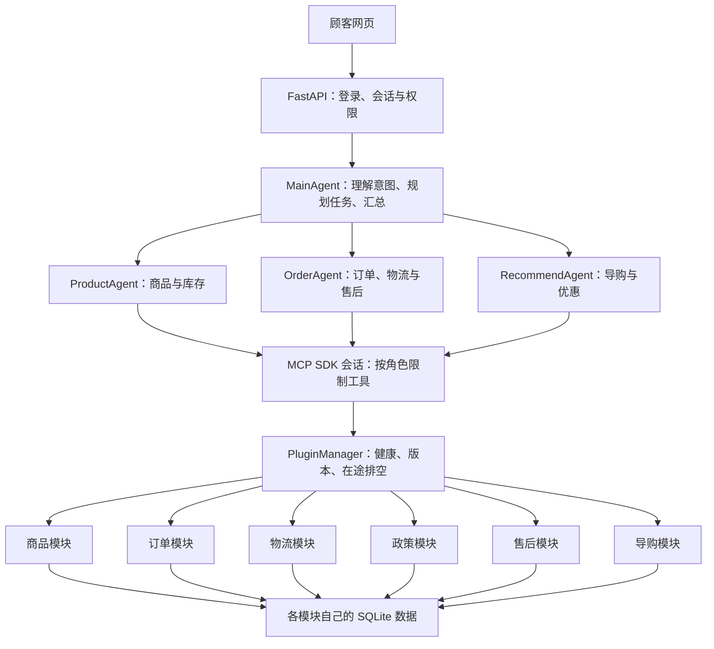
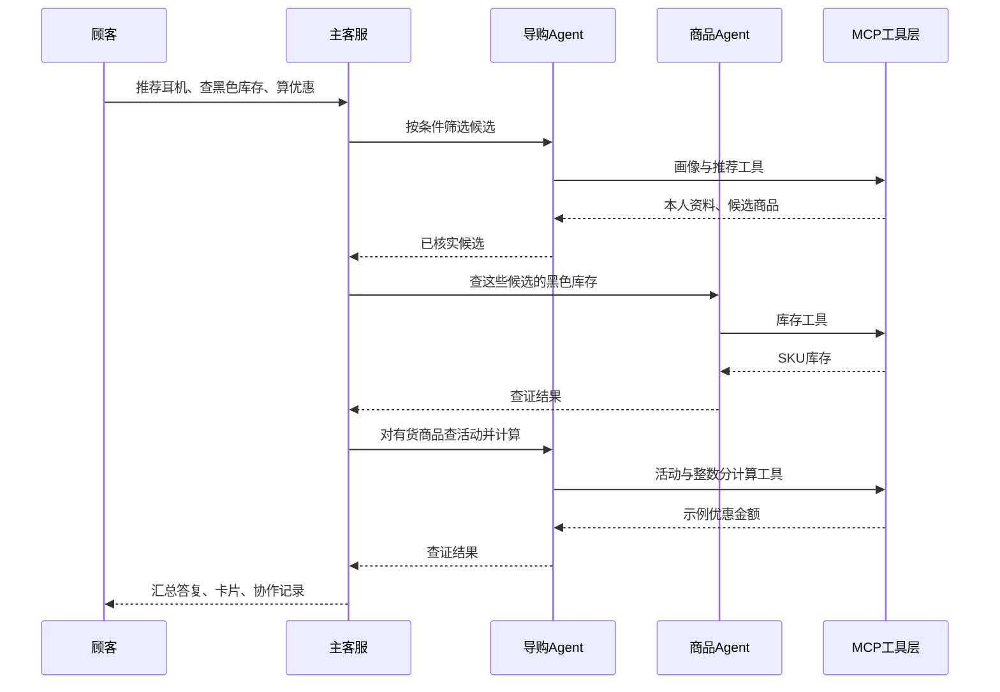

# ShopAgent 当前系统架构

当前结构按原文的“主客服 + 商品 + 订单 + 导购”组织。以下描述代码实现，不把原文生产目标当成已完成能力。

主客服与专业助手用 python-a2a Message 关联任务和会话，当前是本地派发，未部署外部 A2A 网络接口。MCP 使用官方 SDK 内存传输，真正执行协议初始化、目录查询和工具调用；下方业务进程仍通过原有签名 HTTP 接口工作。

## 一次跨角色请求

各专业 Agent 有独立提示、工具白名单和模型消息上下文。前序结果作为数据传给后序。主客服不直接查业务工具，不让模型在汇总时重新改写价格事实。总模型调用和工具调用都有上限，同一顾客会话串行处理。

## 去哪里找代码

| 位置 | 职责 |
|---|---|
| shopagent/app/main.py | API与登录权限 |
| shopagent/agents/main.py | 主客服与规划、调度、汇总 |
| shopagent/agents/registry.py | 三个专业角色及工具权限 |
| shopagent/agents/transport.py | 本地A2A消息与MCP会话 |
| shopagent/core/llm_agent.py | 复用的专业Agent工具循环 |
| shopagent/core/llm_provider.py | 模型HTTP适配器 |
| shopagent/core/registry.py | 独立业务进程的热插拔 |
| shopagent/plugins/ | 各业务工具与数据逻辑 |
| shopagent/web/ | 顾客网页、系统说明、商家后台 |

## 权限和数据

新增 `/customer` 商品咨询入口：服务器创建随机访客身份和8小时凭据，主 Agent 工具目录与宿主调用入口同时限制访客工具范围。访客不能调用订单、物流、会员或售后提交工具。`/merchant` 是商家登录入口，权限仍由服务器验证，隐藏按钮不作为权限保障。

人工咨询直接通过宿主会话服务登记，不依赖模型。管理员查看会话上下文并回复，回复写入原会话；顾客列表计算未读数量，显式读回执只更新本人会话的已读游标。关闭与重新打开记录状态变更。模块业务仍保持独立进程调用。

限流窗口、会话锁和最多8个聊天请求的容量控制均在单宿主进程内；部署时需配可信网关、多实例方案或坚持单宿主运行。当前未增加跨设备访客找回或外部消息通知。

登录身份由服务器绑定，模型和浏览器不能改成别的用户。订单、物流、售后和选购记录各自验证归属。模型不持有管理员启停权限，也不持有售后提交工具。顾客确认按钮走专门的安全接口。三个专业角色共用当前 DeepSeek 配置，API密钥不会交给业务插件进程。

## 当前实现边界

管理后台通过管理员 API 调用各模块自己的工具：商品维护在商品模块，政策草稿/发布版本/历史在政策模块，活动范围和金额在导购模块。新增管理工具不在专业 Agent 的工具白名单中。政策检索与售后资格读取同一份已发布退货规则；优惠试算读取当前有效活动与上架商品标价。政策和活动独立保存，管理界面不直接读写数据库。

业务示例数据、SQLite、本地A2A派发、MCP内存会话；没有标准网络A2A服务、真实店铺API、MySQL生产部署或公网链接。热插拔的是独立业务工具模块；专业角色目前位于宿主进程内。完整差异见《MVP原文对照与迁移》。
