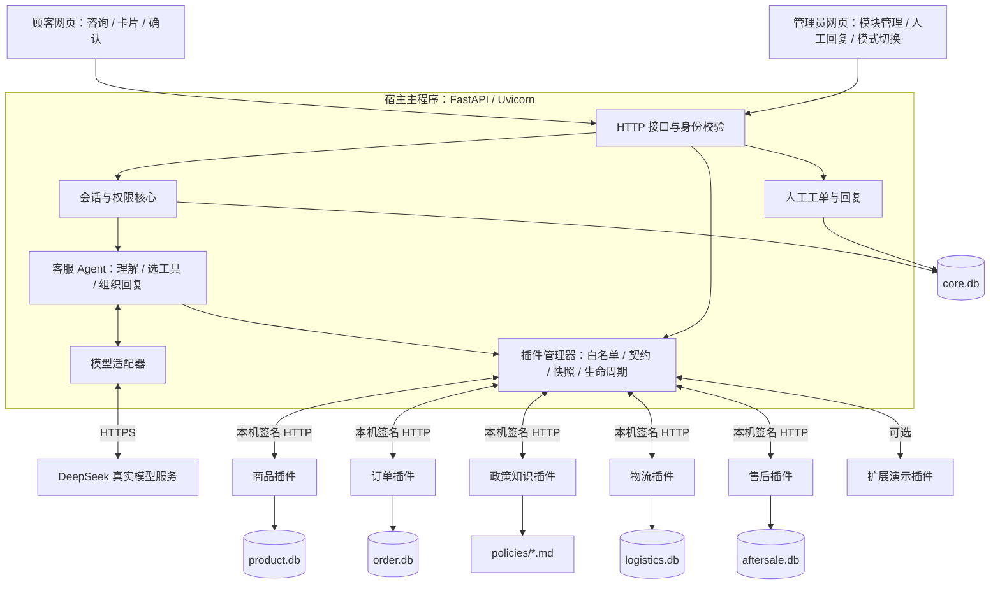
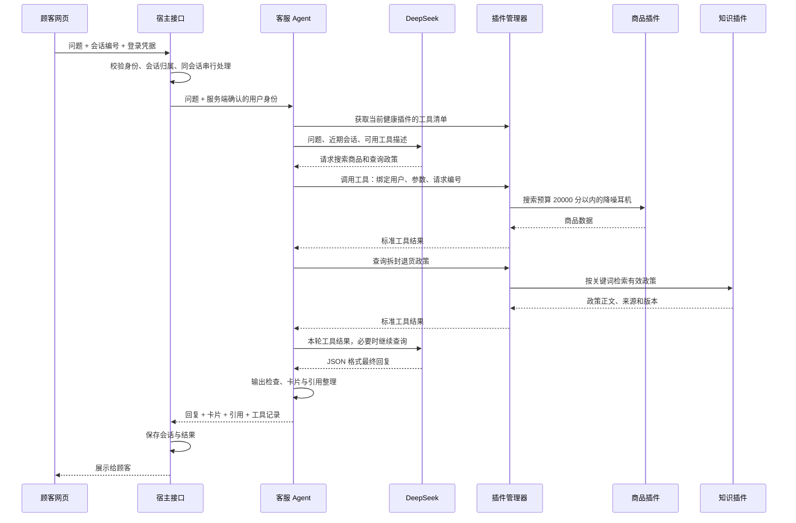
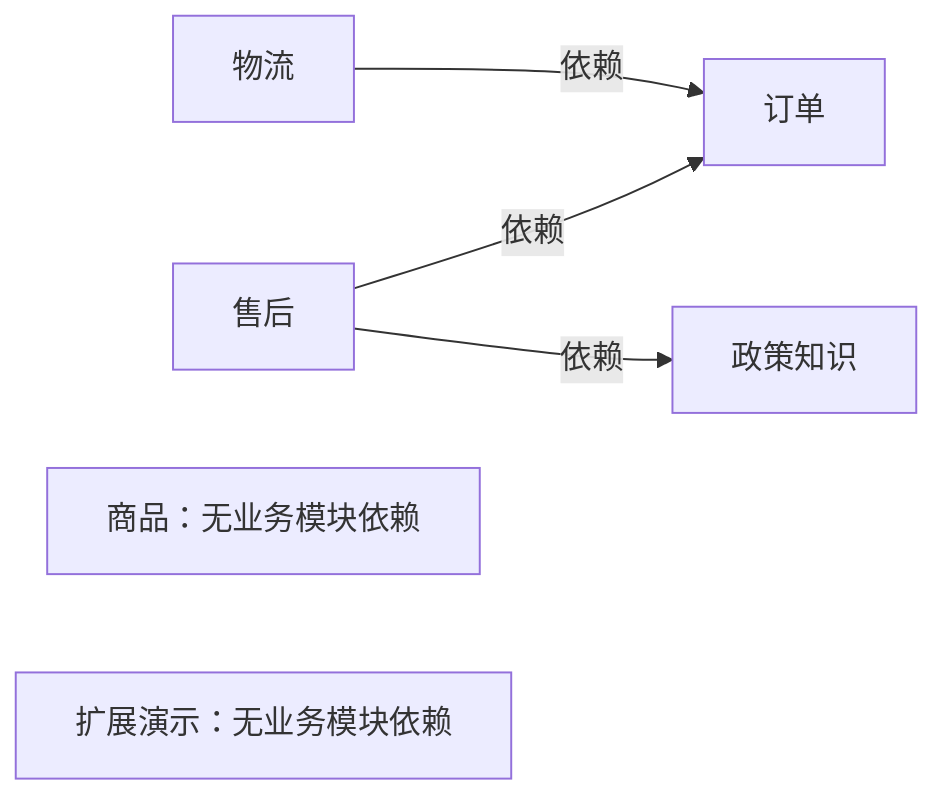
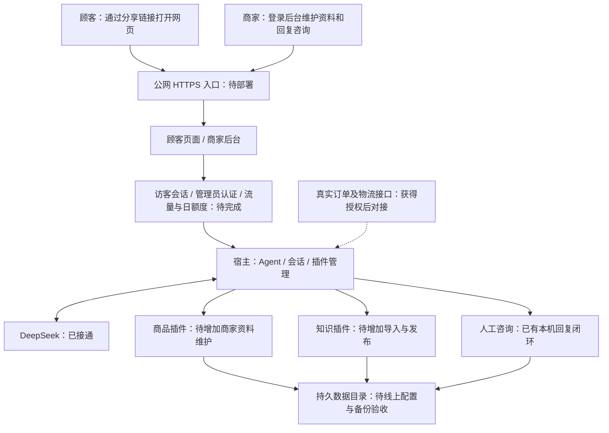

# ShopAgent AI 系统整体架构

版本：架构说明 v1.0。更新：2026-10-09。面向：零经验开发者及后续维护人员。

这份文档依据当前代码整理，并单独标明上线目标。当前已接通 DeepSeek，仍在本机运行，商品、订单、物流和政策为示例数据。

## 1. 先理解它是怎样工作的

把系统理解成一家店的客服工作台：

- **顾客网页**：顾客输入问题、查看答案和商品卡片。
- **客服 Agent**：理解顾客想做什么，选择查询工具，再根据结果组织回复。
- **业务插件**：分别负责商品、订单、物流、政策和售后，提供确定的查询与处理能力。
- **宿主核心**：验证身份、管理会话、调度插件、限制模型可以调用的工具。
- **数据库和资料文件**：保存商品、订单、聊天、工单及政策。
- **DeepSeek**：外部模型服务，为 Agent 提供语言理解和回答生成能力。

“宿主”就是主程序；“插件”是主程序管理的独立业务程序；“工具”是插件向 Agent 提供的具体能力。例如商品插件提供“搜索商品”和“查库存”两个工具。

当前数量：**1 个客服 Agent、5 个业务插件、1 个可选的扩展演示插件**。人工工单属于宿主核心。客服 Agent 和模型适配器运行在宿主进程内，业务插件各自运行在独立子进程中。

## 2. 当前已经实现的整体结构

图中的双向线表示请求和结果往返。DeepSeek 不直接访问数据库：模型提出工具调用，宿主校验后调用插件，将必要结果交回模型。

## 3. 六个层次，各自负责什么

| 层次 | 当前实现 | 主要职责 |
|---|---|---|
| 页面层 | HTML、CSS、JavaScript | 展示咨询、商品、引用、售后草稿和管理界面 |
| 接口层 | FastAPI | 登录、聊天、会话、售后确认、管理接口和内部调用入口 |
| 编排层 | Orchestrator、CustomerAgent | 模式切换、多轮工具循环、上下文整理、结果收集和上限控制 |
| 模型接入层 | HTTPModelProvider | 通过 Chat Completions 或 Responses 协议调用模型服务 |
| 业务能力层 | 独立插件 worker | 商品、订单、知识、物流、售后的参数校验与业务处理 |
| 存储层 | SQLite、Markdown、JSON、日志文件 | 保存业务数据、政策、插件状态及运行记录 |

程序运行方式：**一个宿主管理多个本机子进程**。目前不是跨机器部署的分布式系统；插件端口由宿主自动分配，绑定本机回环地址。

## 4. 一次顾客咨询怎样完成

顾客问：“给我看看两百元内能降噪的耳机，顺便查下拆封退货政策。”

上面是实际已经验证的业务流程。多项工具请求目前由程序逐项执行，尚未并行执行模型提出的工具调用。

模型每次生成的最终回复包含 `kind` 和 `reply`。当它把回复标为事实回答，但本轮没有成功查询到资料时，程序会改为无法核实。有资料也不能保证每句话都正确，仍需要真实问答评测和人工兜底。

## 5. Agent 的能力与边界

当前 Agent 可以调用的插件工具如下，是否可用还取决于对应插件是否健康运行。

| 模块 | Agent 可用能力 | 重要边界 |
|---|---|---|
| 商品 | 搜索商品、商品详情、指定颜色库存 | 金额使用整数“分”，回答元时需要换算 |
| 订单 | 当前用户订单列表、订单状态 | 插件再次校验归属，不能查询其他人的订单 |
| 物流 | 查询指定订单的物流 | 先通过订单模块核验归属，未知到达时间不能承诺 |
| 知识 | 政策检索、受支持版本的售后规则 | 当前为关键词检索，返回正文、来源、版本 |
| 售后 | 准备退货草稿、查询售后进度 | 模型不获得确认提交和取消草稿工具 |
| 人工工单 | 创建人工咨询 | 宿主能力；商家可回复，没有短信或邮件通知 |

模型不能调用管理员接口或执行系统命令，不能自行选择登录身份。售后确认凭据不会发给模型，也不会写入聊天历史。

当前配置每轮最多 6 次模型请求、8 次工具调用，输出上限每次 1200 token，整轮默认 60 秒；每个 Agent 实例最多同时处理 4 轮咨询。近期上下文取最近 12 条消息，每条最多 1500 个字符。这里的 token 是模型计量文本的单位，和登录凭据中的 token 是两个不同概念。

这些是单轮及单实例限制，尚未实现公网访客限流、账户日额度或月度费用上限。模型错误会明确返回，程序不自动重复模型请求，也不静默切换成演示结果。

## 6. 模块独立与热插拔

### 6.1 模块依赖

订单或知识被停用时，其依赖方需要先停用，或由管理员选择级联停用。商品模块不受上述业务依赖影响。

### 6.2 统一契约

每个插件提供三个内部接口：

| 接口 | 通俗含义 |
|---|---|
| `/health` | 告诉宿主“我是否准备好了” |
| `/manifest` | 告诉宿主“我是谁、什么版本、依赖谁、提供哪些工具” |
| `/invoke` | 接收一次工具调用并返回结果 |

请求统一包含工具名称、参数、服务端身份、请求编号和截止时间。返回统一包含成功/失败状态、业务数据、引用、错误码、请求编号和插件版本。输入由 Pydantic 校验；统一返回外壳已定义，具体业务数据目前没有逐工具强类型输出模型。

### 6.3 停用和版本切换

停用流程：停止接纳新调用 → 等待已接纳的调用结束 → 关闭插件进程 → 保存状态。目前排空最多等待 7 秒，不是无限等待；超时的旧进程会被停止。

版本切换流程：启动候选版本 → 健康和契约检查 → 工具结构兼容才接入 → 新请求使用新版本 → 旧版本排空退出。候选失败时保留原版本。Agent 的工具清单来自本轮快照，实际调用时仍检查模块可用性和版本；中途变化可能要求顾客重新发送问题。

当前支持配置好的 1.0.0、1.1.0。商品 1.1.0 有独立的兼容样例代码，其他业务模块的 1.1.0 目前沿用相同业务实现。新增模块先写入本地白名单，重启宿主注册一次，然后才能运行时启停；尚未实现从网络安装任意插件。

登录、会话、宿主接口和 Agent 核心属于主程序，不是可独立卸载的业务插件。模型适配器可以通过代码接口替换；演示/真实模型可在管理员页面切换，已开始的请求继续使用本轮实例。

## 7. 数据存在哪里，谁负责读写

| 数据位置 | 内容 | 负责模块 |
|---|---|---|
| `data/core.db` | 用户、登录凭据哈希、会话、消息、人工工单及回复记录 | 宿主核心 |
| `data/product.db` | 商品和颜色 SKU 库存 | 商品插件 |
| `data/order.db` | 用户订单 | 订单插件 |
| `data/logistics.db` | 模拟物流轨迹 | 物流插件 |
| `data/aftersale.db` | 售后草稿、确认凭据哈希、申请单 | 售后插件 |
| `data/policies/*.md` | 政策正文、标题、版本、有效状态和关键词 | 知识插件 |
| `data/plugins.json` | 插件启用状态、目标版本 | 插件管理器 |
| `data/logs/` | 插件运行日志 | 宿主与插件 |
| `agent.toml` | 模型地址、名称、协议和调用上限 | Agent 配置模块 |
| 本地 `.env` | 模型 API 密钥 | 宿主服务端读取 |

SQLite 是保存在文件里的数据库，当前开启 WAL 模式处理读写。知识模块使用 Markdown 文件，没有向量数据库；扩展演示插件不需要业务数据库。

插件业务代码只操作自己的数据，跨模块查询通过宿主的内部 HTTP 接口。例如售后插件通过工具查询订单与政策，不直接读取订单表。**这是代码和数据所有权的分工，不是操作系统级文件隔离沙箱**；当前只运行本地可信白名单代码。

商家资料导入、编辑和发布页面尚未实现，因此现在的数据仍由示例初始化程序创建。

## 8. 两个需要单独理解的业务流程

### 8.1 售后提交

顾客说明意图与条件 → Agent 请求售后插件生成草稿 → 插件核验订单和政策 → 页面展示草稿与确认按钮 → 顾客持有短期确认凭据提交 → 插件重新核验当前条件并幂等创建申请。

“幂等”的意思是：重复提交同一有效草稿，系统返回同一申请，避免重复创建。当前只创建示例申请，真实退款和取件没有对接。确定性售后规则目前只支持预设政策版本；替换真实政策时，需要同步实现和验证对应规则。

### 8.2 人工回复

顾客转人工 → 宿主保存咨询工单 → 管理员后台查看并回复 → 回复保存到原会话 → 顾客点击“查看客服回复”读取消息。

直接输入“转人工”可由宿主创建咨询，即使模型不可用也能使用。目前顾客主动刷新查看回复，没有自动推送、短信、邮件或外部客服系统集成。

## 9. 身份、秘密和外部数据流

登录验证后，服务端识别用户为买家或管理员；浏览器提交的工具参数不能替代服务端身份。订单、会话、草稿和申请按用户隔离，管理员操作由宿主检查角色。

用户密码用带盐 PBKDF2 哈希保存，登录凭据服务端保存哈希、有效期 8 小时；网页凭据在当前标签页的 sessionStorage 中保存。内部插件调用带 HMAC 签名和时间戳；这是当前可信本机服务间的认证机制，不等于支持不可信第三方插件。

模型密钥保留在服务端，不交给网页，不随日志或管理员接口返回。调用真实 DeepSeek 时，问题、近期会话及必要工具结果会发送到外部模型服务；真实店铺上线前需要明确允许发送的资料和顾客告知方式。

目前有本机演示用户和演示密码，公网用户身份体系及生产管理员初始化尚未实现。

## 10. 上线 MVP 的目标结构：这些部分待完成

第一版围绕**商品咨询、政策问答、人工回复**形成单店铺可分享的服务。顾客咨询入口与商家管理入口分开；涉及私有订单时需要可信顾客认证，而不是让访客直接输入订单号就查数据。

资料管理拟增加：商品导入/编辑、政策和 FAQ 维护、格式检查、草稿与已发布版本、发布后检索生效。相应写入由各业务模块负责，管理接口检查商家权限，Agent 查询已发布资料。

部署目标是一个服务实例管理插件，公网入口连接宿主，业务 worker 端口继续保持内部访问。需配置持久存储、日志、备份恢复、失败处理和费用控制。当前插件管理器是宿主内状态，尚未支持多个宿主或多个 Uvicorn worker 的协同管理。

没有真实订单接口时，线上隐藏示例订单、物流和自动售后入口。后续获得店铺接口授权，再接入真实业务能力。扩展到多商家、跨机器服务、消息队列或向量检索，需要另外设计和验收，当前实现不包含这些组件。

## 11. 架构对应到哪些源码

| 组件 | 入口文件 |
|---|---|
| 启动宿主 | [shopagent/run.py](C:/Users/44332/Documents/ChatGPT/智能电商客服/shopagent/run.py) |
| 外部及内部接口 | [app/main.py](C:/Users/44332/Documents/ChatGPT/智能电商客服/shopagent/app/main.py) |
| 演示/真实模型编排 | [core/orchestrator.py](C:/Users/44332/Documents/ChatGPT/智能电商客服/shopagent/core/orchestrator.py) |
| 客服 Agent 工具循环 | [core/llm_agent.py](C:/Users/44332/Documents/ChatGPT/智能电商客服/shopagent/core/llm_agent.py) |
| 模型协议适配 | [core/llm_provider.py](C:/Users/44332/Documents/ChatGPT/智能电商客服/shopagent/core/llm_provider.py) |
| 插件管理与生命周期 | [core/registry.py](C:/Users/44332/Documents/ChatGPT/智能电商客服/shopagent/core/registry.py) |
| 认证、会话与工单 | [core/sessions.py](C:/Users/44332/Documents/ChatGPT/智能电商客服/shopagent/core/sessions.py) |
| 插件统一进程入口 | [plugins/worker.py](C:/Users/44332/Documents/ChatGPT/智能电商客服/shopagent/plugins/worker.py) |
| 请求、身份及返回契约 | [contracts/models.py](C:/Users/44332/Documents/ChatGPT/智能电商客服/shopagent/contracts/models.py) |
| 顾客和管理页面 | [web/index.html](C:/Users/44332/Documents/ChatGPT/智能电商客服/shopagent/web/index.html) |

## 12. 当前证据与下一步

当前代码的全量自动测试为 96 项通过；DeepSeek 已完成有限样本的实际咨询、工具调用及权限检查。详见 [真实模型验证记录](C:/Users/44332/Documents/ChatGPT/智能电商客服/docs/DeepSeek真实模型验证记录.md)。这些证据验证本机实现，不能替代公网访问、真实店铺数据和生产运维验收。

后续开发顺序：**商家资料维护 → 顾客线上身份与入口 → 限流及费用控制 → 持久化部署和 HTTPS → 实际店铺问答与外部手机验收**。真实订单集成在获得接口后另行加入。
