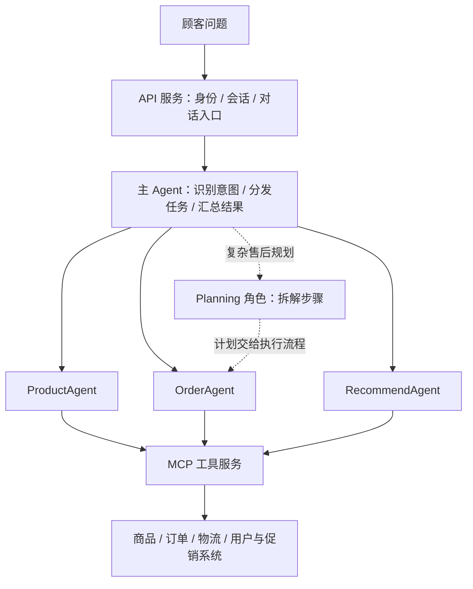

> 历史阶段说明：当前重构版以项目 README.md、《MVP原文对照与迁移》和《ShopAgent系统整体架构》为准。

# 原始完整文档的 Agent 与编排

来源：[ShopAgent 原始项目正文](C:/Users/44332/Documents/ChatGPT/智能电商客服/docs/ShopAgent-AI-原始项目正文.txt)。主要对应原文 3.3、3.5、4.2–4.4、7.1 节。更新：2026-10-09。

## 一、原文定义了哪些 Agent

原文明确列出 **3 个业务子 Agent**：

| 名称 | 职责 | 原文关联工具 |
|---|---|---|
| ProductAgent 商品查询助手 | 商品搜索、详情、库存、价格比较 | search_products、get_product_detail、check_inventory、compare_prices |
| OrderAgent 订单跟踪助手 | 订单状态、物流、退换货和售后进度 | get_order_status、track_logistics、apply_return、get_return_status |
| RecommendAgent 智能导购助手 | 用户画像、个性化推荐、促销、会员权益及优惠计算 | get_user_profile、get_recommendations、query_promotions、calculate_discount |

此外，原文还描述两种编排角色：

- **主 Agent**：意图分类、任务分发、跨 Agent 结果汇聚。原文没有为它统一指定 RouterAgent 或 SupervisorAgent 这样的类名。
- **Planning Agent**：在复杂售后示例中拆解步骤，再由 ReAct 循环逐步执行。原文未明确它是否属于独立服务、独立部署的第 4/第 5 个 Agent，或者是编排内的一种规划角色。

因此，准确表述是“主路由 + 3 个业务子 Agent，复杂任务使用 Planning 与 ReAct”，不能直接断言原文有 5 个独立部署的 Agent。原文统计表的“3 个 Agent”统计的是三个命名业务子代理。

## 二、整体编排

图是根据原文整理的解释图，不是已实现服务拓扑。原文的架构分层是 API Server、A2A Agent、MCP Server；主 Agent 和子 Agent 的任务与结果通过 A2A 传递，业务能力通过 MCP 工具访问。

通俗理解：A2A 管“Agent 之间怎样派任务”；MCP 管“Agent 怎样调用商品、订单等工具”。这两层不是同一个职责。

## 三、8 类意图怎么路由

按原文 3.5 节的正式意图表：

| 意图 | 含义 | 处理 Agent | 原文复杂度 |
|---|---|---|---|
| product_query | 查询商品 | ProductAgent | 简单 |
| price_compare | 比较价格 | ProductAgent | 简单 |
| inventory_check | 检查库存 | ProductAgent | 简单 |
| order_query | 查询订单 | OrderAgent | 简单 |
| logistics_track | 跟踪物流 | OrderAgent | 简单 |
| return_apply | 退换货 | OrderAgent | 复杂 |
| recommend_query | 导购推荐 | RecommendAgent | 复杂 |
| promotion_query | 促销活动 | RecommendAgent | 简单 |

原文还有一处将 member_benefit 列为 RecommendAgent 的处理意图，摘要中的八类中文枚举也与 3.5 表不同。这是原文口径不一致，实施时需统一意图集合和测试，不宜直接照搬所有枚举。

## 四、三种执行方式

### 简单问题：直接路由

顾客问订单在哪里 → 主 Agent 识别物流意图 → OrderAgent → 查询订单 → 查询物流 → 汇总答复。

“直接路由”指不用先做完整计划，不表示完全绕过模型或业务权限验证。

### 复杂售后：Planning + ReAct

顾客请求退货 → 收集缺失资料 → 规划核验订单、核验资格、申请处理、取件安排等步骤 → 执行工具 → 观察结果 → 决定下一步 → 返回进度。

ReAct 在此可以理解为“决定做什么 → 调工具 → 看结果 → 再决定”。原文核心执行引擎描述为 LangChain 的 Agent Loop；尚未给出完整可运行的编排源码、状态恢复和失败补偿实现。

原文中的预计退款、取件和保修示例不是已核验的业务承诺。落地时需使用真实业务规则，保修期不能代替退货资格；有实际影响的提交应保留确认和审核边界。

### 跨 Agent 导购：按结果衔接

顾客问“预算 500 元，给妈妈选礼物” → RecommendAgent 获取画像及候选商品 → ProductAgent 检查候选库存 → RecommendAgent 查询活动、计算优惠、整理推荐 → 汇总返回顾客。

前一步输出成为后一步输入。例如没生成候选商品前，库存助手不知道应该检查哪些商品。原文后半部分明确用串行库存查询简化实现，因此不能把“多 Agent 协作”理解为“所有任务都并行执行”。

## 五、与当前项目的区别

| 项目 | 原文设计 | 当前实现 |
|---|---|---|
| Agent 编排 | 主路由 + 三个业务子 Agent | 一个 CustomerAgent 直接选择多个业务工具 |
| 规划 | 描述 Planning + ReAct | 有有界工具循环，没有独立 Planning Agent |
| Agent 通信 | A2A | 没有实现 A2A 子 Agent 通信 |
| 工具协议 | FastMCP / MCP | 自定义签名 HTTP 插件协议，不是标准 MCP Server |
| 专业分工 | 商品、订单、推荐三个 Agent | 商品、订单、知识、物流、售后五个业务插件 |
| 导购 | 用户画像、推荐、促销与优惠工具 | 目前有商品筛选；画像、独立推荐及促销优惠能力未实现 |
| 数据 | 描述真实电商系统和 MySQL | 当前 SQLite/Markdown 示例资料，模型为真实 DeepSeek |

五个业务插件不是五个 Agent。当前版本是对原文的 MVP 简化实现，尚未完成原文描述的多 Agent 架构。

如果后续要求完整复现原文，需要增加主路由与汇总、三个业务 Agent 的任务接口与专业提示、跨 Agent 协作、导购工具以及明确的复杂任务状态管理，并决定是否采用原文的 A2A/MCP 协议。实施前需先补齐真实资料和业务规则，避免只有代理名称，没有可用能力。
