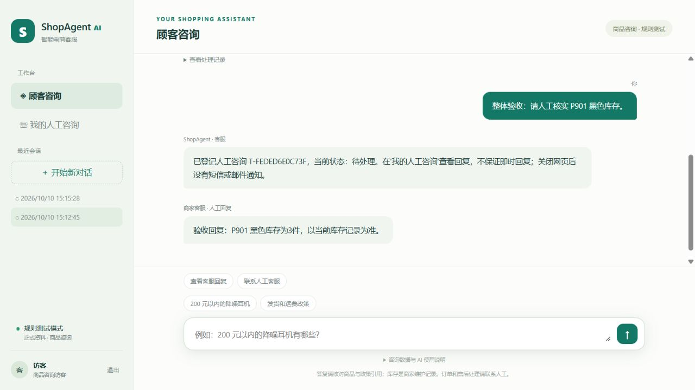
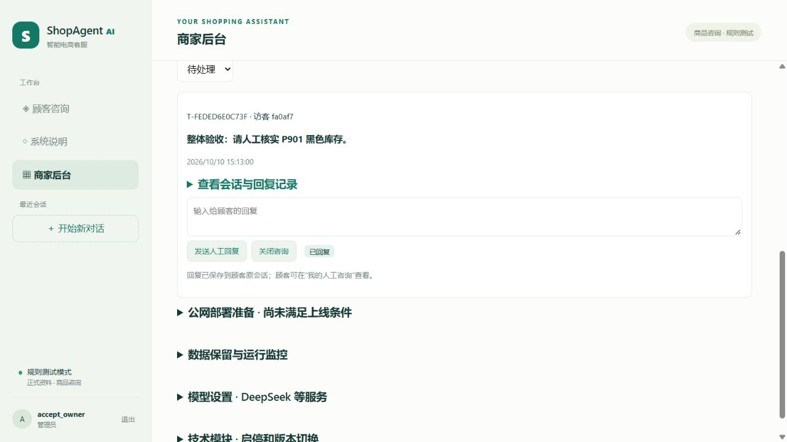

# ShopAgent AI 整体验收与部署打包报告

验收日期：2026-10-10（北京时间）。发布版本：2.0.0。

**结论：当前 MVP 通过本机及临时 Linux 容器验收，具备单台服务器部署的源码和模板。尚未公网部署。** 服务器、域名、可信公网证书和真实店铺资料仍需准备。

## 一、你现在拿到的是什么

这是“独立客服网页 + 商家人工工作台”的 MVP：顾客查商品、库存、优惠和政策，无法解决的问题登记人工；商家在后台回复，顾客在原会话查看。

程序有4个角色：MainAgent 编排、ProductAgent 商品、OrderAgent 订单、RecommendAgent 导购。角色调用独立工具模块；模块可以启停、升级或回退。正式首发仅启用商品、政策、导购工具，订单、物流、售后和扩展演示工具保持关闭。订单角色存在不代表真实订单业务已上线。

模型支持 DeepSeek 接入，验收使用规则模式和模型桩，不消耗真实模型额度。上线前还要使用服务器上的真实密钥、模型配置和审核资料进行小范围答复验收。

## 二、本轮最终检查结果

| 检查 | 结果 | 说明 |
|---|---|---|
| Windows 全量回归 | 209项通过，135.74秒 | 最后一次完整运行，含新增2项打包边界检查 |
| Linux 全量回归 | 209项通过，52.26秒 | 官方 Python 3.13 slim 容器，解压的源码，全新安装锁定依赖 |
| 依赖安装与一致性 | 通过 | Linux 从锁定清单安装成功；Windows/Linux `pip check` 均无冲突 |
| 部署包正式环境检查 | 22项通过 | ZIP 解压、清单哈希、空正式库、随机测试管理员、商品发布、两位顾客与人工闭环、正常停止 |
| JavaScript 语法 | 6个文件通过 | Node `--check`，修正库存提示后单独复验 |
| 浏览器实际操作 | 通过 | 阅读说明 → 开始咨询 → 查 P901 临时库存 → 登记人工 → 商家回复 → 顾客原会话查看 |
| 浏览器错误 | 未发现新增错误 | 本轮临时顾客与商家页面 error 日志均为空 |
| Nginx 网关实测 | 8类检查通过 | 配置、TLS证书验证、伪造代理头、内部入口、错误Host、413、429、HSTS |

Linux 测试镜像摘要：`python@sha256:70729b46c69b4f1e97c4822c1af3df53a1476cf5ddc6c087c0c10bc3a5678c2f`。

Nginx 使用已有官方测试镜像，方法见《公网网关验收记录》。容器未对公网开放端口；临时宿主仅监听回环地址。Linux容器检查不包含 systemd 服务启动，也不替代实际服务器验收。

证据保存在本机忽略目录：`test-results/release-acceptance-final.xml`、`test-results/linux-release/linux-regression.xml`、`test-results/linux-release/linux-package-smoke.json`。最终部署包的复验结果保存在部署包目录的 `package-smoke.json`、`archive-audit.json`，以实际执行结果为准。

## 三、功能覆盖到什么程度

| 能力 | 通过的边界 | 正式上线范围 |
|---|---|---|
| Agent 编排 | 多步串行协作、角色工具限制、证据缺失、澄清、工具循环限制、模型失败处理 | 商品咨询与导购；不是全部业务自动处理 |
| 商品维护 | 草稿、价格和库存、审核发布、下架、导入冲突、编辑版本冲突 | 顾客只见已发布真实资料 |
| 政策与优惠 | 草稿/发布/停用、有效期、活动范围、优惠计算、历史记录 | 经营者须先核实政策与活动 |
| 人工客服 | 上下文、回复防重、归属隔离、未读与已读、关闭及重开 | 网页查询回复；没有短信/邮件通知 |
| 账号和会话 | 正式管理员初始化、演示账号禁止、访客8小时、跨顾客隔离、权限检查 | 访客不是经过店铺验证的买家身份 |
| 模块热插拔 | 依赖检查、级联停用、在途请求排空、版本切换/回退、崩溃隔离、重启保留状态 | 独立进程、独立数据库、单宿主 |
| 店铺运营 | 店铺信息、每日请求次数额度、暂停AI、失败也占额 | 次数限额，不是精确金额预算 |
| 数据维护 | 默认关闭的清理、只清理符合条件的旧访客、未关闭工单保护、脱敏事件 | 保留期限、值守、外部告警由实际店铺确定 |
| 备份恢复 | 停机快照、校验、损坏拒绝、恢复新目录、注销旧凭据、默认暂停AI | 实际服务器还须演练恢复和异地保存 |
| 请求网关 | Host限制、可信单机代理、512KiB、上传超时、内部接口屏蔽、限流 | 单机Nginx直接面对顾客；不支持直接加CDN |

## 四、验收发现的问题与修复

1. Linux锁定依赖包含仅Windows可用的 `pywin32`，导致跨平台部署受阻。已改为带 `sys_platform == "win32"` 条件；Linux全新安装通过。
2. Linux服务停机后进入 `TIME_WAIT`，启动前的端口探测把它误报成已有服务占用。已让Unix预检查采用与Uvicorn一致的地址复用选项；Windows保持原检查。修正前Linux有14项失败（服务重启失败导致后续连接失败），修正后完整209项通过。
3. Nginx模板原PID路径位于 `/tmp`，不适合直接配合常见Linux服务PID路径。现改为 `/run/nginx.pid` 并重验网关。实际发行版的服务配置仍须核对。
4. 正式顾客入口的库存快捷提示固定引用示例 `P001`。已替换为通用库存信息提示；实际网页确认会先要求明确商品，不猜测库存。
5. 新增打包工具：允许目录、秘密与数据库排除、已配置密钥内容检查、模型初始规则模式、文件哈希、ZIP/tar.gz、外部校验和。新增解压后的正式环境验证工具。

## 五、部署包怎样使用

首先阅读 [部署包使用说明](../deploy/README.md)。

- **Windows查看或本机练习**：使用ZIP。解压后创建本机虚拟环境，按说明安装依赖、初始化正式管理员。
- **Linux服务器部署**：使用tar.gz。在服务器重新创建虚拟环境，按Nginx/systemd步骤配置。不要复制Windows `.venv`。
- **检查包没有下载损坏**：使用旁边的SHA256SUMS文件核对。包内清单可逐文件检查。

包内不含任何现有账号、业务数据库、备份、密钥、日志或虚拟环境；新安装需要自己初始化管理员、录入资料和填写模型配置。`agent.toml` 从mock开始，防止解压后意外发起付费模型请求。压缩包含源码与文档，依赖安装需要网络；不是离线依赖镜像。

打包从当前Git源码生成，清单记录来源提交以及是否还有未提交改动。最终交付包应来自干净提交，不能将预检目录中的 `-working` 包当作最终交付。不要直接修改已交付ZIP中的源码后继续使用旧校验和。

## 六、下一步上线的顺序和通过标准

| 顺序 | 操作 | 通过标准 |
|---|---|---|
| 1 | 准备Linux服务器、域名，确定系统版本和单机部署范围 | 可管理服务器，域名解析到正确地址 |
| 2 | 上传最终包，核对SHA256，在新目录安装Python与依赖 | `pip check` 通过；源码不带本机秘密 |
| 3 | 配置专用用户、生产数据目录、受保护的环境文件 | 目录权限正常；一个数据目录只跑一个宿主 |
| 4 | 隐藏输入初始化正式管理员，先用mock启动 | 演示密码无效，空正式库，顾客和商家入口可访问 |
| 5 | 录入审核后的商品/库存、政策/优惠、店名、联系方式和值守安排 | 顾客只查询真实已发布资料；完成一次人工回复 |
| 6 | 在服务器本地配置DeepSeek、调用额度和暂停开关 | 小范围答复有引用，失败可转人工，费用可观察 |
| 7 | 配置systemd、Nginx、可信证书、防火墙与续期 | 语法检查通过；80/443可访问；8001及模块端口不对公网开放 |
| 8 | 停机备份，恢复到新目录，重启后重新登录 | 商品、会话和人工回复可恢复；AI默认暂停 |
| 9 | 手机用移动网络访问外网，两位顾客互相隔离，验证人工/限流/重启 | 无证书警告，关键流程全部通过后再分享给少量顾客 |

服务器密码、SSH私钥、模型密钥都在本地或服务器填写，不通过聊天提交。

## 七、本轮未验收及明确限制

- 没有服务器，因此真实systemd、目录权限、防火墙、域名DNS、公网TLS、自动续期和外网可达性待验收。
- 没有对真实DeepSeek进行付费重复测试；最终模型、真实商品政策与实际答复仍需上线前验收。
- 没有真实订单身份绑定、订单平台接口、支付、退款或取件服务，不开放这些交易业务。
- 没有多实例/高可用、向量检索库、CDN、长期跨设备会话找回或主动消息通知。
- 本轮不是独立渗透测试，也不是大规模压力测试；访问量、模型预算与值守安排需在试运行中观察。

## 页面证据

以下全为隔离验收环境的虚构商品与咨询，没有改动当前店铺数据。

